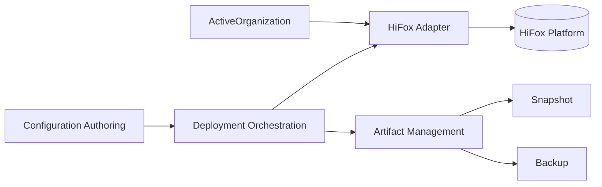

# 上下文地图

## 上下文

| 上下文 | 位置 | 职责 |
|---|---|---|
| **Configuration Authoring** | 父仓库 `config/<config-set>/` | 维护期望状态：crew、agent、skill、名称模板、可见性、target、model policy；与 Organization/Space 解耦。 |
| **Deployment Orchestration** | 子模块 `src/commands/`、`src/deploy.mjs`、`src/state.mjs`、`src/validate.mjs` | 校验、生成 DeploymentPlan、Provision、Reconcile、Snapshot、Backup。 |
| **HiFox Adapter** | 子模块 `src/hifox.mjs`、`src/flags.mjs`、`src/organization.mjs` | 把领域动作翻译成 `hifox` CLI 参数；解析并校验 ActiveOrganization；dry-run 时抑制 mutation。 |
| **Artifact Management** | 子模块 `src/commands/pull.mjs`、`backup.mjs`、`restore.mjs`、`prune.mjs` | 生成 Snapshot 与 Backup，执行 Restore/Prune；不参与核心领域不变量。 |
| **HiFox Platform**（外部） | HiFox 远端 | Organization、Space、Crew、Agent、Skill、Computer/Runtime。 |

## 上下文关系

`ActiveOrganization` 是适配器的环境依赖：Environment 声明的是目标 Organization，但真正的 `hifox` 调用使用有效组织（`--organization-id` > `HIFOX_ORGANIZATION_ID` > profile 默认组织）。两者不一致时，工具必须 **fail fast**，不自动切换组织；修复由用户显式执行 `hifox organization switch` 或设置 `HIFOX_ORGANIZATION_ID`（见 ADR 0001）。

## 聚合与一致性边界

| 名称 | 类型 | 包含 | 一致性 |
|---|---|---|---|
| **Environment** | 聚合根 | `DeploymentState` | 一个 Environment 只绑定一个 Organization、一个 Space、一个 ConfigRoot；state 按 Environment 隔离。 |
| **CrewConfig** | 聚合根 | — | leader/members 必须引用存在的 AgentConfig；key 与目录名一致。 |
| **AgentConfig** | 聚合根 | — | key 与目录名一致；target computer/runtime 成对。 |
| **SkillConfig** | 聚合根 | — | content 存在；assignTo 引用存在的 AgentConfig；binding 合法。 |
| **ConfigurationSet** | 校验边界，**不是聚合根** | 对 CrewConfig / AgentConfig / SkillConfig 的引用 | key 唯一、目录匹配、渲染后名称全局唯一、跨聚合引用存在。 |

`ConfigurationSet` 不是事务性聚合：文件可以独立编辑，跨文件不变量由 `validate` 在部署前统一检查。这样既保留独立编辑的便利，也避免把整个配置集合塞进一个巨大的聚合。配置集合本身与 Organization/Space 解耦；Organization/Space 由 Environment 绑定。

## 读写模型

| 模型 | 方向 | 说明 |
|---|---|---|
| 配置文件 | 写（人） | 期望状态的事实来源。 |
| `state.yaml` | 写（工具） | key → UUID 的身份映射，是远端身份的唯一事实来源。 |
| Snapshot | 读（工具） | 远端状态的只读缓存，可重建。 |
| Backup | 归档 | 不可变历史；不参与运行时决策。 |

## 关键依赖

- **Configuration Authoring → Deployment Orchestration**：通过 `configRoot` 与 `environment.yaml` 提供输入。
- **Deployment Orchestration → HiFox Adapter**：所有远端调用必须经过 `src/hifox.mjs`；adapter 不能反向依赖命令层。
- **Deployment Orchestration → Artifact Management**：Snapshot/Backup 只消费 state 与远端读模型，不修改期望状态。
- **HiFox Adapter → ActiveOrganization**：调用前必须校验有效组织与 Environment 声明一致；不一致 fail fast，不自动切换（见 ADR 0001）。
